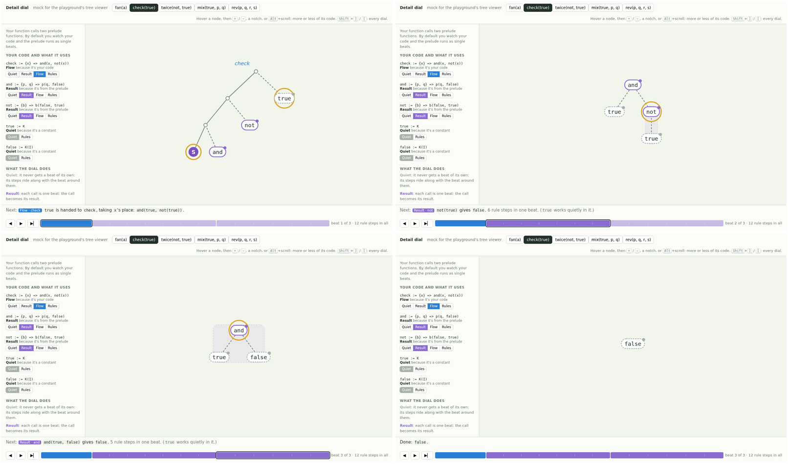
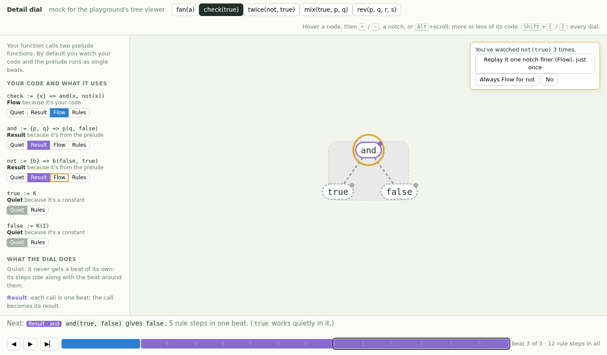

# The detail dial: one control for how much of a run you watch

*Archived 2026-11-05: an 11-round design study (reviews went 6.1 → 7.3 → 7.0). The existing tree viewer was preferred, so none of this was built.*

A design for the playground's tree viewer. The mock is in this folder: open
`archive/playground-dial/index.html` on the dev server that `scripts/dev-server.sh` starts (add `?ex=fan`, `?ex=check` or `?ex=twice`).
It runs a toy S/K/I reducer instead of tree calculus, eager like disp's evaluator, with every argument worked out
before its call starts (see "The reel's order" below). It keeps its call stack the way the playground's
`Trace.calls` does. Its steps are the same kinds of step the playground shows; triage groups the same way.

`node archive/playground-dial/invariants.mjs` checks the design's main promise over every combination of settings
of every example: turning any dial down a notch never adds beats. It also checks that the beats always cover the
run exactly. It passes: 2,708 turns, none adding beats.

The mock covers:
- the dial: hover, `+`/`−`, clicking a notch, Alt+scroll, Shift+`]`/`[`, and the side list
- the four settings and the beat cutting
- the hand-off and call animations
- boxes and captions
- the replay and skimming suggestions, and Back playing a beat in reverse
- examples built from their source lines by a small bracket-abstraction compiler, the same rules disp's compiler
  uses (`[x]x = I`, `K` when `x` isn't used, eta, `S` otherwise), so the S/K/I on screen are what that source
  compiles to
- `shoot.mjs`'s `walk` action, which prints every beat's caption under any settings, for checking a cut quickly

It doesn't have touch, the editor-cursor hint, binder steps, triage or parallel mode; those are described here only.

## The problem

Today every rewrite is its own beat:
- `add(2, 3)` is 111 rule steps.
- An argument handed through a compiled function takes three to ten steps before it reaches the places it is used.

Different readers want different things from the same run:
- A newcomer wants to see the argument arrive.
- Someone learning the rules wants every step.
- Someone debugging `check` wants to watch `check`, not `and`'s insides.

These are the same run watched at different grain, and the grain someone wants differs from one piece of code to
another.

## The idea in one sentence

Each definition has a **dial** that says how much of its calls you watch, from none to every rule, and the run is cut
into beats by reading the call stack against those dials.

## What the dial controls

One thing: **how much of this definition's work you see.** That means space and time together, because they always
go the same way: less means fewer nodes drawn and fewer beats played. A separate fold control and speed control
would let the two disagree, with an open subtree whose steps are skipped or a closed box whose insides take 40 beats.
Every such mix is confusing.

| Setting | On screen | In time |
|---|---|---|
| **Quiet** | a box with its name, outlined dashed | never a beat of its own: its steps ride along with the beat before them |
| **Result** | a box with its name, holding its arguments below it | each call is one beat: the call becomes its result, calls it makes included |
| **Flow** | the code drawn open, as S, K and I, with its name above it | each hand-off is one beat: an argument travels to every place it is used |
| **Rules** | the same | every rule is its own beat (today's viewer) |

*Hovering any node shows the dial for the code it belongs to. Every node of that code lights up, so you can see
what the dial covers before you turn it.*

### Defaults: inferred from who wrote what

- **Your code** (definitions in the open buffer) starts at **Flow**: you see your arguments land. If that would
  be more than 30 hand-offs in this run (a recursive `add(2, 3)` is 51), it starts at **Result** instead, and the
  side list says so: "Result because it's your code, but 51 hand-offs is a lot: + for Flow".
- **Imported code** (the prelude, other files) starts at **Result**: one beat per call.
- **Constants** (`true`, `false`, numbers) start at **Quiet**: a boolean picking a branch is part of whoever asked.
  - The side list offers constants only Quiet and Rules; the middle two mean nothing for a constant.
  - The expression being run offers only Flow and Rules.

The side list says why each one is where it is ("Result, because it's from the prelude"), and says "you set this"
once you've changed it. When a definition's calls all run inside someone else's beat (stepped over inside a
Result or Quiet `check`), its row says so: "(stepped over inside `check`)".

*`check(true)` at the defaults: three beats instead of twelve rule steps. `not(true)`, an argument, runs before `and`
starts.*
1. `true` is handed through `check` and lands in `and(…)` and `not(…)`.
2. `not(true)` gives `false`.
3. `and(true, false)` gives `false`.

*The call a Result beat will run is outlined before and while it plays, and the thing the next beat acts on is
ringed: the call, for a Result beat; the argument and the combinator that takes it, for a hand-off.*

### Turning it

- **Plain values** (an argument like `p`, built by nobody's code) have no dial; hovering one says so.
- **Hover a node and press `+` / `−`** (or `]` / `[`), or click a notch on its ring. That node's definition gets
  more or less detail. **Alt+scroll** turns it too. Plain scroll stays the camera's zoom and pan, so moving around
  never re-cuts the run.
- **Shift+`]` / Shift+`[`** turns every dial one notch at once.
  - `+` itself needs Shift on most keyboards, so it only ever means one dial.
  - It is an offset on top of each dial, so the differences between dials stay, and it goes back exactly.
  - It stops where one more notch wouldn't change a single beat.
  - It leaves dials you've set by hand alone ("you set this; Shift leaves it"), and the side list says which: "Shift
    +2 on every dial, except `not` (you set it)".
  - It leaves constants alone until its top notch: one notch past "all code at Rules", constants show their rules
    too, so the top really is every rule.
- **The side list** has the same settings per definition, so you can see and set everything without hunting for a
  node. Hovering a row lights its nodes.
- **Touch:** tap a node to select it and show its ring, then tap a notch. Long-press stays free for the canvas.
- **Clicking a dial's current setting again** gives it back to its default. A dial counts as set by hand (📌) only
  when it differs from its default. **Back to the defaults**, in the side
  list, undoes everything.

When you turn a dial, the stage doesn't jump. The same frame stays on screen, and boxes open or close in place:
children grow out of the box, or fold back into it. The timeline re-cuts at once. If the frame on screen is now in
the middle of a beat, a playhead tick marks where in it you are, and the next → finishes that beat rather than
rewinding.

## How the run is cut into beats

### The reel's order: arguments before the call

The reel stays eager, with two ordering rules (today's reel goes innermost-first, so `and(true, not(true))` fires
`and(true)` before `not(true)` has run):
- **A named call works out all its arguments** (left to right) before it starts.
- **Inside a body, a combinator fires as soon as its own arguments are ready**, before the calls the body built
  further along the spine. So `twice` finishes its own plumbing (including dropping a copy it no longer needs)
  before `not(true)` runs.

Steps on separate subtrees don't affect each other, so this is the same run in a different order: the same steps,
the same result, and it stops in the same cases. But it means **a call never starts before its arguments are
ready**, which is how people read eager code. It also makes each call **one unbroken stretch of steps, nested like
a stack**, and everything below depends on that.

The playground's trace already keeps the **call stack** (`Trace.calls`):
- **Opening:** a call opens when the function part of the firing application is a named definition. It climbs the
  spine, so `and(true, x)` is one call.
- **Closing:** a call closes when nothing under its site can fire any more.

A step works for the innermost open call.

### Cutting

A run is cut into beats at **boundaries** between steps. Whether two neighbouring steps are split is a yes/no
question decided by the calls around them. Every condition can only switch off as a dial goes down, so turning a dial
down only ever **removes** boundaries: it merges beats and never moves one. `invariants.mjs` checks this
exhaustively: every one-notch turn, in every combination of settings of every example (2,708 turns).

At each boundary these calls have a say:

1. **The innermost call holding both steps**, by its setting:
   - **Rules:** always, except before a Quiet call (see riders).
   - **Flow:** before a call that isn't Quiet, and between its own steps when the argument being handed on changes.
   - **Result** and **Quiet:** never inside themselves.
2. **A call starting or ending there**, if it is set to Result or finer: a call is a beat of its own. A call's end
   doesn't split off a rider or quiet work that follows it, so after a breakpoint, quiet code rides with the
   breakpoint's last beat.

A say is **overruled** when a Result or Quiet call encloses the call that has it (step-over). It isn't overruled
when something between them breaks out:
- a call set finer than Result, like a breakpoint inside a step-over, so turning detail up somewhere always shows it;
- in **your own code**, a recursive call of the same definition, so at Result each call is its own beat. Your own
  `add(2, 3)` at Result is five beats, one per call level ("`add(2, 3)` runs until `add(1, 3)` starts", …,
  "`add(2, 3)` finishes: 5"), between Flow's 51 and Quiet's 1.
- Imported code at Result **steps over its own recursion**: the prelude's `add(60, 1)` is one beat. Who wrote the
  code doesn't change as you turn dials, so this keeps the rule that turning down only merges.

**Riders** go with the beat before them. Which steps ride is a fixed property of the step, not of anyone's
setting:
- every step whose code is **Quiet**, wherever it runs, even at Rules: `true` picking a branch is part of whoever
  asked;
- at Flow, and after a call ends, a step that hands on none of its call's arguments, or only throws a copy away
  (K): a boolean dropping the branch it didn't pick, or `twice` dropping a copy of `true` it no longer needs, isn't
  a hand-off.

At Rules, every other step is its own beat, K drops included.

What the settings come to:

| Setting | A beat is… | Played as |
|---|---|---|
| Rules | one step (Quiet code inside it rides along) | the step's own animation |
| Flow | the call's steps that hand on one of its arguments (and that argument's copies) | **hand-off**: the argument travels along the tree's edges to each combinator that passes it on. It splits at S, ends at K and passes through I, and lands where it is used while the rest of the tree glides into place. Only the routes to a landing are drawn strong: a copy that is only thrown away leaves a thin, faint trail, and the code's other plumbing steps back while the hand-off plays. The hand-off ends at its last real step, and the landing holds for a moment before any riders play. → during the hold or the riders finishes the whole beat |
| Result | the call, or each piece of it around a breakout or a recursive call | **call**: the call is outlined, everything it used up fades where it stood, and its result rises in its place. The result holds for a moment before any riders play |
| Quiet | nothing of its own: it rides along with the beat before (the whole run, if nothing comes before) | inside that beat's animation; the caption says "then `and(true, false)` gives `false`, quietly" |

**Captions** come from the call records and the definitions' source:
- A hand-off reads the way the code was written. The argument takes its parameter's place in the body, with the
  arguments handed so far filled in:
  - "`not` is handed through `twice` and takes `f`'s place: `not(not(x))`, waiting for `x`"
  - then "`true` … takes `x`'s place: `not(not(true))`"
  - "`true` … takes `b`'s place: `true(false, true)`"
- Calls read as calls: "`not(true)` gives `false`".
- A call cut into pieces reads "runs until `not(true)` starts, which you're watching more closely", then
  "`check` finishes: …".
- Captions name what rode along: Quiet code inside the beat, a call that ran after it ("then `and(true, false)`
  gives `false`, quietly", never its rule steps), a copy thrown away.
- Each beat is tagged with its call's setting, which always matches the side list (`invariants.mjs` checks that
  too).
- The raw rule text is only for Rules.

### Composing step animations

Each rule step already has an animation: the viewer's node matching between two frames, plus where the leftovers go.
The dial adds no new kind of step. It composes runs of them and picks a renderer for the composite.

Composing two steps means composing their matchings. A node in the later frame came from a node in the earlier
frame, from a copy of one, or is new. A node of the earlier frame went to zero, one or more nodes of the later one.
So any run of steps has a direct animation from its first frame to its last, and only the renderer differs.

*One Flow beat replacing three rule steps:*
1. `a` enters `fan` along the tree's edges and reaches its top S. The S lights up and sends a copy down each side.
2. One copy reaches the inner S, which hands it to both `f` and `g`.
3. The other copy reaches `K(h)` and ends there, because `fan`'s body doesn't use `x` next to `h`.
4. The trail stays drawn until the argument lands, so the route reads as a picture of where `x` was in the source.
5. The scaffold fades while the result settles in.

This is the full argument traversal as one motion. S, K and I stop being three rules to memorise and become a route
map: **S means used on both sides, K means not used here, I means here**. Bracket abstraction, which turned
`{x} => …` into that map, is the same map read backwards. The binder steps at the start of the reel group the same
way: at Flow, all the steps that take one binder off (S split, K wrap, I, eta) are one beat, building the variable's
route.

*A Result beat: the call stays outlined, `not(true)` fades where it stood, and `false` rises in its place.*

### Big code at Flow: the source, with holes

Bracket abstraction makes a large scaffold for a function with several parameters: `rev`'s four parameters are
30-odd S/K/I nodes, and tree calculus is bigger still. Followed as routes, a hand-off through that scaffold lights
half of it. So when a definition compiles to more than a dozen combinators, Flow draws it **as its source, with each
parameter a hole** (the side list says so: "Flow, drawn as its source: 32 combinators"):
- an empty hole shows its parameter's name, faded: `rev: f(d, c, b, a)`;
- the arguments still waiting hang below the box, as for any call;
- each hand-off flies its argument up to **its own hole**, and the name there turns solid when it arrives;
- a call in the body that has run reads as its result: in `mix := {a, b, c} => f(not(a), c, b, g(c))`, `not(a)`
  can run as soon as `a` is in. It runs as its own beat at `not`'s setting, and then the box reads
  `f(false, c, b, g(c))`;
- the caption reads the body the same way: "`p` is handed to `mix`, taking `b`'s place: `f(false, c, p, g(c))`".

The full S/K/I drawing is still there at Rules, and small functions keep the S/K/I route at Flow. That route is
the "S means used on both sides" picture, and it reads well up to about two parameters.

## Boxes

At Result or Quiet, a definition's code is drawn as a **box with its name**, with what it holds that is someone
else's (its arguments) hanging below. An application belongs to the function being applied, so
`and(true, not(true))` is a box `and` holding `true` and the box `not(true)`.

- **"…" marks a call partway through**, whose own code isn't whole any more: `and…`, holding `true`. Folding by
  name instead would show raw S/K/I whenever a call is partway. Open code (at Flow or Rules) is named the same way
  above its top node: `twice`, then `twice…` once its first argument has gone in.
- **Only code at work is boxed:** a definition, or a call that can still fire or is waiting for arguments. A
  finished value is shown as what it is, even when a box's code built it: `fan(a)` ends as `f(a, g(a), h)`, not
  as `fan…`.
- **Constants written in a definition's text** (`not`'s own `false` and `true`) are part of its box, unless they sit
  where the call's arguments go.
- **Other definitions named in its text**, and any call that hasn't started yet, are their own boxes, even of the
  same function: `not(not(true))` is two boxes, even after `twice` handed `not` along. A breakpoint on `not` inside a boxed `check` shows.
- **A box shows each argument once**, even when S has copied it inside.

In the playground, boxes come from the same call records: an open call's site, its name, and its arguments
(`Call.args`). The one thing call records can't say is that a function value is still the definition it came from
after being handed along: `twice` passes `not` on, and the copy that later gets called is still `not`. That needs
the same composed origin maps as Flow's argument tracking, run from frame 0 for function values too. It is
bounded work, the same maps over the same steps, but it is new. The real `#noteCall` names calls by id today, and
would name them by where the function came from instead.

## Inferring intent beyond the defaults

The dial is the reader saying what they want. The viewer may *suggest* a turn, but it never turns a dial by itself,
and the number of beats never changes behind your back.

- **Turning a dial up right after a beat re-plays it.** If the turn splits the beat you just watched into finer
  ones, the view goes back to its start, so → shows it at the new setting. That is an explicit request, not a
  guess. Turning down never moves the stage.
- **Watching a beat a third time means "I didn't follow that".** Replays caused by your own dial turns don't count,
  and the count for a definition starts over when you turn its dial. A note offers:
  - **Replay it one notch finer, just once:** plays that stretch at the finer grain, then goes back.
  - **Always (that setting) for `and`:** turns the dial.
- **Racing through one definition's beats means "I don't need this".** Racing means cutting a beat short: pressing
  → before half of it has played, or during its hold or riders.
  - Two races in a row through the same code offer one notch less, down to Quiet. The race counts for the beat it
    cut short.
  - If none of that code's beats are left, the offer reads "next time": the dial still changes for a replay or a
    re-run.
  - → while a beat plays (hold and riders included) lands on its end and never starts the next one, so one press
    is one beat.
  - After Shift has been used, skimming isn't offered: the reader has already said how much they want.
- **"No" is remembered** for that definition, and the viewer never suggests anything about a definition you set by
  hand. An offer goes away at the next →.
- **The editor cursor is attention.** Putting the cursor in a definition's text outlines its next notch in the side
  list, as a suggestion you accept with `+`.
- **Play is not a signal.** Pressing Play doesn't change the cut. It plays beats at a steady rhythm.
- **Back** plays the beat's own animation in reverse.

## How it fits the playground

- **The reel stays one list of rule steps.** The dial only cuts it into beats, so stepping, scrubbing, the step
  count and the editor's verdicts don't change. The timeline shows beats, with ticks for the steps inside.
- **Call stack:** `Trace.calls` has each call's name, arguments, start, end, depth and site. The design adds two
  things:
  - each call's parent;
  - the ids of its arguments, which the trace already records in `Call.args`.

  The trace's `nextPath` changes to arguments-first; `fireAt` and parallel mode need to record calls too (they
  don't today). Parallel mode records them per round, by path.
- **Flow beats** need each step's argument (the `z` of `△(△x)y z` for S, K and triage) and which of the call's
  arguments it is a copy of. The store hash-conses equal trees into one id, so ids can't tell `and(true, true)`'s
  two arguments apart, or an argument from a constant equal to it. The viewer tracks arguments **by position**
  instead. It composes per-step origin maps across the call, starting from the argument slots at the call's
  start. `guides.ts` has them for binder steps today; the three runtime rules need them added:
  - S: the copy of `z`
  - K: the drop
  - F: the branch it picks
  
  This is new, bounded work.
- **Calls carry their definition** from the compiler's definition roots and their positions at frame 0, not from
  looking a name up by id. Names are keyed by id and the first definition wins, so two definitions that compile to
  the same tree would share a dial, and a named bare leaf would make every leaf-building step look like a call.
  - The two rules that build data (`R_LEAF`, `R_STEM`) hand nothing on. They go with the beat around them.
- **The hand-off renderer** can reuse `argFlow` in `TreeCanvas.svelte`, which already reads a combinator's route
  (drop / returns / looks / gets) for the hover overlay.
- **Triage** (F) at Flow plays as a hand-off that ends at the F node: the argument arrives, and the branch that
  matched it lights up. Triage takes its argument apart, and **the pieces count as that argument**, both for where
  a Flow beat ends and for the origin maps. So a function that inspects its argument hands it on in one beat, not
  one per piece.
- **Binder steps** (the compile phase at the start of the reel) belong to the definition being unwrapped, and are
  cut by its dial like its run steps: at Flow, one beat per binder; at Result, one beat for the whole compile; at
  Quiet, they ride along with its first run beat.
- **Parallel mode.** A round is the smallest unit: one round is one beat at Rules. At coarser settings, each round
  is cut by the outermost call that fires in it, and consecutive rounds with the same cut merge.
- **Scrubbing** needs only the call records (already kept for every frame) and the beat list, which is recomputed
  when a dial turns. The scan is linear in the number of steps and keeps no state per node.
- **Measured** on the real `Trace` as it is today (innermost-first, `DEFS.add`, where `add` is one raw tree with its helpers inlined; arguments-first runs the same steps):

  | Run | Rule steps | `add` at Flow | `add` at Result (a beat per call) | `add` at Quiet |
  |---|---|---|---|---|
  | `add(2, 3)` | 111 | 51 | 5 | 1 |
  | `add(4, 1)` | 187 | 87 | 9 | 1 |
  | `add(6, 6)` | 263 | 123 | 13 | 1 |

  Flow halves the beats of raw code. The bigger savings come from named helpers: in the prelude, `add` calls
  `succ`, `nat_pred` and `is_leaf`, each one beat at Result.
- **The existing toggles** (names on/off, numbers as trees, S/K/I letters) stay as display options. The fold button
  goes away: a fold is a dial at Result.

## Things tried and dropped

- **Geometric zoom as the detail control** (zoom in, see more steps): a camera move that changes how many beats
  there are is a surprise, and on a phone you zoom all the time. For the same reason, plain scroll doesn't turn the
  dial.
- **Two dials, one for space and one for time:** every mixed setting is confusing.
- **Turning dials automatically** from replays or the cursor: right some of the time, and when it's wrong the reel
  changes under you. Suggestions and one-time replays get the benefit without the surprise.
- **Ownership by who built each node, credited by tree position** (two earlier versions of this design): after a
  tail call the builder is gone, and the rules piled up exceptions. The call stack answers "whose work is this
  step" directly.
- **Keeping innermost-first order** (a third version): a call's later arguments were worked out in the middle of
  it, so its steps came in pieces. That needed exceptions for "argument steps", produced beats in which nothing
  visibly happened, and let "less" give more beats in some settings.
- **Folding by name:** shows raw combinators whenever a call is partway.
- **Per-call scope** ("just this call of `not`") as the main scope: the same function behaves the same way wherever
  it runs, and per-definition settings fit in one short list. Per-call stays possible later as Alt-turn.
- **Dragology-style direct manipulation** (pull a node to play its step): appealing for teaching a single rule, but
  it doesn't answer "how much do I want to see". It could be added on top: dragging plays the current beat at
  whatever grain the dial gives.

## Open questions

1. Should Flow show the argument travelling *into* a box (a Result-level function receiving it), or stop at the
   box? The mock stops at the box.
2. Recursive code at Result is a beat per call: five for `add(2, 3)`. For deep recursion (`add(60, 1)`), should
   Result fold calls past some depth into their caller?
3. Where exactly is "big" for the source-with-holes view at Flow? The mock uses more than 12 combinators; tree
   calculus compiles bigger, so the playground's number will differ.
